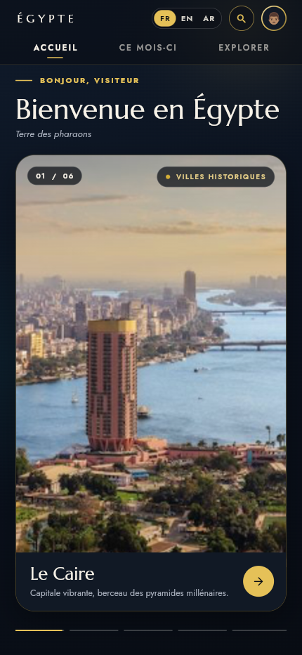
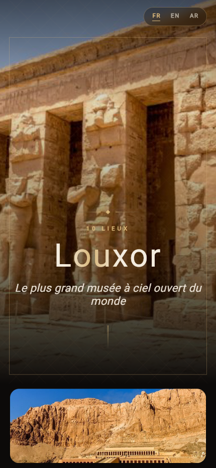
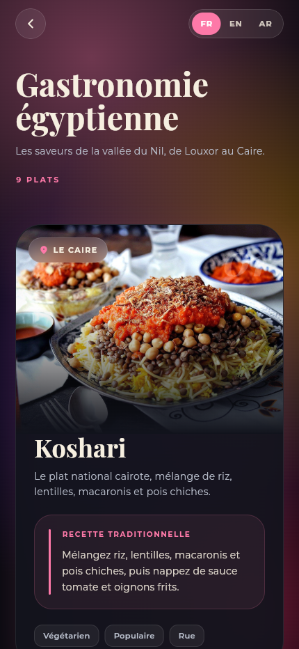
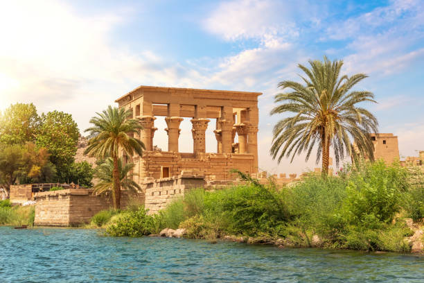
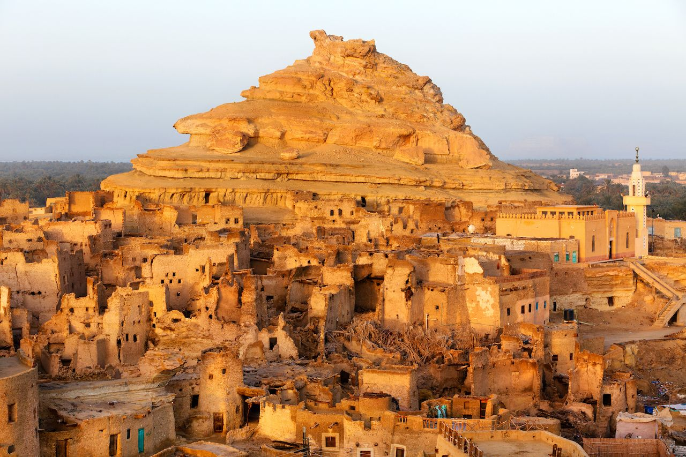

# 🇪🇬 Égypte

> **Voyagez en Égypte en toute sérénité.**

Découvrez l’Égypte autrement avec une application pensée pour vous accompagner dans la préparation de votre voyage. Explorez les destinations incontournables, découvrez la culture égyptienne et retrouvez des informations utiles dans une seule application.

## ✨ À propos de l’application

**Égypte** est une application mobile développée avec **Flutter**. Elle propose un guide de découverte du pays à travers ses villes, ses paysages, son patrimoine et sa culture.

Que vous prépariez votre premier séjour ou que vous souhaitiez simplement découvrir les merveilles égyptiennes, l’application vous invite à explorer le pays à votre rythme.

## 📲 Parcours de l’application — étape par étape

Voici le parcours de découverte de l’application, présenté dans l’ordre réel : **une étape, une image unique**. Chaque image provient d’un écran Flutter du projet. Les captures sont affichées côte à côte pour suivre facilement la progression.

> Les captures sont réalisées dans un navigateur mobile (430 × 932 px). Chaque fichier correspond à une seule capture d’écran ; aucune série de captures n’est assemblée pour fabriquer une image.

### Étapes 1 à 7 — démarrage de l’application

| Étape | Écran réel | Étape | Écran réel |
|:---:|:---:|:---:|:---:|
| **1. Choix de la langue** | <a href="docs/screenshots/01-choix-langue.png"></a> | **2. Découverte** | <a href="docs/screenshots/02-presentation-decouverte.png"></a> |
| **3. Expériences** | <a href="docs/screenshots/03-presentation-experiences.png"></a> | **4. Bienvenue** | <a href="docs/screenshots/04-presentation-bienvenue.png"></a> |
| **5. Création du profil** | <a href="docs/screenshots/05-creation-profil.png"></a> | **6. Accueil** | <a href="docs/screenshots/06-accueil.png"></a> |
| **7. Paramètres** | <a href="docs/screenshots/07-parametres.png"></a> | | |

### Étapes 8 à 18 — destinations et découvertes en grand format

À partir des destinations, chaque capture est affichée **seule sur sa ligne et en grande largeur** pour mieux voir les photos, les textes et tous les détails de chaque page. Cliquez sur une image pour l’ouvrir à sa taille originale.

#### 8. Le Caire

<a href="docs/screenshots/08-le-caire.png"></a>

#### 9. Alexandrie

<a href="docs/screenshots/09-alexandrie.png"></a>

#### 10. Louxor

<a href="docs/screenshots/10-louxor.png"></a>

#### 11. Assouan

<a href="docs/screenshots/11-assouan.png"></a>

#### 12. Siwa

<a href="docs/screenshots/12-siwa.png"></a>

#### 13. Fayoum

<a href="docs/screenshots/13-fayoum.png"></a>

#### 14. Désert

<a href="docs/screenshots/14-desert.png"></a>

#### 15. Charm el-Cheikh

<a href="docs/screenshots/15-sharm-el-sheikh.png"></a>

#### 16. Hurghada

<a href="docs/screenshots/16-hurghada.png"></a>

#### 17. Gastronomie égyptienne

<a href="docs/screenshots/17-gastronomie.png"></a>

#### 18. Hiéroglyphes égyptiens

<a href="docs/screenshots/18-hieroglyphes.png"></a>

**Progression :** choix de la langue → présentation → profil → accueil → paramètres → destinations et découvertes culturelles.

### Détails des écrans

Les descriptions ci-dessous détaillent le contenu de chaque page, dans l’ordre du parcours. Les images correspondantes sont présentées dans le schéma du parcours ci-dessus.

### 1. Choix de la langue

- Scène d’ouverture inspirée du Nil, avec une ambiance qui évolue au fil de la journée.
- Nom de l’application affiché dans la langue sélectionnée.
- Panneau de sélection des langues : français, anglais et arabe.
- Question, libellés et bouton de validation adaptés à la langue choisie.
- Mise en page adaptée à l’écriture de droite à gauche pour l’arabe.

### 2. Présentation — Découverte de l’Égypte

- Première étape de l’accueil introductif.
- Présentation de l’Égypte, de son histoire, de ses sites, de sa culture et des expériences de voyage.
- Visuel immersif et textes localisés.

### 3. Présentation — Expériences

- Deuxième étape du parcours de présentation.
- Cartes illustrant plusieurs expériences : vallée des Rois, désert, croisière sur le Nil et traditions culinaires.
- Images, titres et pictogrammes associés à chaque expérience.
- Navigation vers l’étape suivante.

### 4. Présentation — Bienvenue

- Dernière étape de la présentation.
- Message invitant à commencer le voyage.
- Texte d’introduction et signature de l’univers de l’application.
- Accès à la création du profil.

### 5. Création du profil

- Écran de création du profil utilisateur.
- Interface localisée en français pour cette capture de référence.
- Présentation des informations nécessaires au profil.
- Étape de validation avant d’accéder à l’application.

### 6. Accueil

- Message de bienvenue et identité visuelle de l’application.
- En-tête et accès aux paramètres.
- Sélection de destinations recommandées selon le mois.
- Exploration des destinations par thème.
- Recherche d’une destination et affichage des résultats.
- Accès aux villes, aux régions, à la gastronomie et aux hiéroglyphes.
- Sections et contenus verticaux affichés dans leur intégralité.

### 7. Paramètres

- Personnalisation du nom et du profil.
- Choix du genre et de l’avatar.
- Sélection de la couleur du thème parmi les couleurs proposées.
- Choix de la langue : français, anglais ou arabe.
- Bouton d’enregistrement des modifications.

### 8. Le Caire

- Page consacrée à la capitale égyptienne : présentation de la destination, visuels et sections de découverte.
- Capture verticale complète.

### 9. Alexandrie

- Page consacrée à Alexandrie et à son patrimoine méditerranéen : présentation, images, textes et rubriques de découverte.
- Capture verticale complète.

### 10. Louxor

- Page consacrée à Louxor et à son patrimoine antique : présentation, visuels et contenus de découverte.
- Capture verticale complète.

### 11. Assouan

- Page consacrée à Assouan et aux paysages du Nil : présentation, images, textes et sections.
- Capture verticale complète.

### 12. Siwa

- Page consacrée à l’oasis de Siwa : présentation de la destination, contenus visuels et rubriques de découverte.
- Capture verticale complète.

### 13. Fayoum

- Page consacrée à la région du Fayoum, à ses paysages et à ses sites naturels.
- Images, textes et sections de découverte ; capture verticale complète.

### 14. Désert

- Page consacrée aux paysages désertiques égyptiens.
- Présentation de l’univers du désert, visuels et contenus de découverte.
- Capture verticale complète.

### 15. Charm el-Cheikh

- Page consacrée à Charm el-Cheikh et à la mer Rouge : présentation, images, textes et rubriques de découverte.
- Capture verticale complète.

### 16. Hurghada

- Page consacrée à Hurghada et à son littoral : présentation, visuels et contenus de découverte.
- Capture verticale complète.

### 17. Gastronomie égyptienne

- Page dédiée à la cuisine égyptienne et à ses spécialités culinaires.
- Photographies, textes et contenus consacrés aux saveurs locales.
- Capture verticale complète.

### 18. Hiéroglyphes égyptiens

- Page dédiée aux hiéroglyphes et à l’écriture de l’Égypte ancienne.
- Présentation des symboles et de leur univers avec des éléments visuels et pédagogiques.
- Capture verticale complète.

### Langues et parcours de navigation

L’application propose trois langues : **français, anglais et arabe**. Le code de l’accueil et des paramètres prévoit les trois localisations. Les captures de cette galerie utilisent le français comme langue de référence ; les écrans ne constituent donc pas trois séries de captures linguistiques distinctes.

Le parcours documenté suit l’ordre suivant : choix de la langue → présentation en trois étapes → création du profil → accueil → paramètres et rubriques de découverte.

### Mise à jour automatique des captures

Les captures sont générées automatiquement par GitHub Actions à partir du code Flutter du dépôt, avec le fichier de démonstration `tool/screenshot_harness.dart` et Playwright dans Chromium. Chaque écran est enregistré dans son propre fichier PNG. Le workflow se lance lors d’une mise à jour de la branche `main` (sauf lorsqu’il s’agit uniquement des captures) ou manuellement depuis l’onglet **Actions**.

Les images sont enregistrées dans `docs/screenshots/`. Le workflow vérifie la présence des 18 fichiers et contrôle qu’ils ne sont pas identiques avant de les valider dans le dépôt. Les captures correspondent à un rendu navigateur mobile de l’application Flutter, et non à des photographies prises sur un téléphone physique.

## 🏛️ Destinations à découvrir

L’application présente plusieurs régions et destinations d’Égypte :

- **Le Caire** – découvrez la capitale, son histoire et ses sites emblématiques.
- **Alexandrie** – explorez la ville méditerranéenne et son patrimoine.
- **Louxor** – plongez au cœur de l’Égypte antique.
- **Assouan** – découvrez le Nil et les paysages du sud.
- **Siwa** – partez à la découverte de l’oasis et du désert.
- **Fayoum** – explorez ses lacs et ses paysages naturels.
- **Le désert** – découvrez les grands espaces et les paysages désertiques.
- **Charm el-Cheikh** – profitez de la mer Rouge et de ses environs.
- **Hurghada** – découvrez une autre destination incontournable de la mer Rouge.

## 🖼️ Quelques destinations en images

| Le Caire | Alexandrie |
|:---:|:---:|
|  |  |
| **Louxor** | **Assouan** |
|  |  |
| **Siwa** | **Fayoum** |
|  |  |
| **Le désert** | **Charm el-Cheikh** |
|  |  |
| **Hurghada** | |
|  | |

## 🌍 Fonctionnalités

- **Découverte des destinations :** des pages consacrées aux principales régions touristiques du pays.
- **Culture et patrimoine :** des contenus pour découvrir l’histoire, les hiéroglyphes et les traditions égyptiennes.
- **Gastronomie :** une découverte de la cuisine et des spécialités locales.
- **Application multilingue :** interface disponible en français, en anglais et en arabe.
- **Profil personnalisé :** possibilité de configurer son profil et certains éléments de personnalisation.
- **Expérience mobile :** une navigation conçue pour consulter les informations facilement.

## 🛠️ Technologies utilisées

- [Flutter](https://flutter.dev/) – développement de l’application.
- [Dart](https://dart.dev/) – langage de programmation.
- [Google Fonts](https://pub.dev/packages/google_fonts) – typographie.
- [GetX](https://pub.dev/packages/get) – gestion de certaines fonctionnalités et de la navigation.
- [Shared Preferences](https://pub.dev/packages/shared_preferences) – sauvegarde locale des préférences.
- [URL Launcher](https://pub.dev/packages/url_launcher) – ouverture de liens externes.

## 🚀 Lancer le projet

Assurez-vous d’avoir installé [Flutter](https://docs.flutter.dev/get-started/install), puis clonez le dépôt :

```bash
git clone https://github.com/Coco921609/Egypte.git
cd Egypte
```

Installez les dépendances :

```bash
flutter pub get
```

Lancez l’application :

```bash
flutter run
```

Pour générer une version Web :

```bash
flutter build web --base-href "/Egypte/"
```

## 📁 Structure du projet

```text
Egypte/
├── assets/
│   └── images/        # Images des destinations
├── lib/               # Code source Flutter
├── test/              # Tests du projet
├── pubspec.yaml       # Dépendances et ressources
└── README.md          # Présentation du projet
```

## 📱 Télécharger l’application

| Plateforme | Accès |
|---|---|
| **Android** | [Télécharger sur Google Play](https://play.google.com/store/apps/details?id=com.egypte) |
| **iPhone / iPad (version Web)** | [Ouvrir l’application sur GitHub Pages](https://coco921609.github.io/Egypte/) |

## 🔗 Liens

- **Dépôt GitHub :** [Coco921609/Egypte](https://github.com/Coco921609/Egypte)
- **Documentation Flutter :** [docs.flutter.dev](https://docs.flutter.dev/)

---

**Égypte – Voyagez en Égypte en toute sérénité.** 🇪🇬
