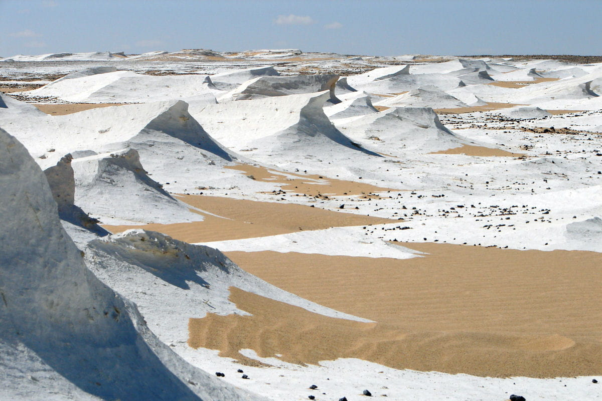

# 🇪🇬 Égypte

> **Voyagez en Égypte en toute sérénité.**

Découvrez l’Égypte autrement avec une application pensée pour vous accompagner dans la préparation de votre voyage. Explorez les destinations incontournables, découvrez la culture égyptienne et retrouvez des informations utiles dans une seule application.

## ✨ À propos de l’application

**Égypte** est une application mobile développée avec **Flutter**. Elle propose un guide de découverte du pays à travers ses villes, ses paysages, son patrimoine et sa culture.

Que vous prépariez votre premier séjour ou que vous souhaitiez simplement découvrir les merveilles égyptiennes, l’application vous invite à explorer le pays à votre rythme.

## 🏛️ Destinations à découvrir

L’application présente plusieurs régions et destinations d’Égypte :

- **Le Caire** – découvrez la capitale, son histoire et ses sites emblématiques.
- **Alexandrie** – explorez la ville méditerranéenne et son patrimoine.
- **Louxor** – plongez au cœur de l’Égypte antique.
- **Assouan** – découvrez le Nil et les paysages du sud.
- **Siwa** – partez à la découverte de l’oasis et du désert.
- **Fayoum** – explorez ses lacs et ses paysages naturels.
- **Le désert** – découvrez les grands espaces et les paysages désertiques.
- **Charm el-Cheikh** – profitez de la mer Rouge et de ses environs.
- **Hurghada** – découvrez une autre destination incontournable de la mer Rouge.

## 🖼️ Quelques destinations en images

| Le Caire | Alexandrie |
|:---:|:---:|
|  |  |
| **Louxor** | **Assouan** |
|  |  |
| **Siwa** | **Fayoum** |
|  |  |
| **Le désert** | **Charm el-Cheikh** |
|  |  |
| **Hurghada** | |
|  | |

## 🌍 Fonctionnalités

- **Découverte des destinations :** des pages consacrées aux principales régions touristiques du pays.
- **Culture et patrimoine :** des contenus pour découvrir l’histoire, les hiéroglyphes et les traditions égyptiennes.
- **Gastronomie :** une découverte de la cuisine et des spécialités locales.
- **Application multilingue :** interface disponible en français, en anglais et en arabe.
- **Profil personnalisé :** possibilité de configurer son profil et certains éléments de personnalisation.
- **Expérience mobile :** une navigation conçue pour consulter les informations facilement.

## 🛠️ Technologies utilisées

- [Flutter](https://flutter.dev/) – développement de l’application.
- [Dart](https://dart.dev/) – langage de programmation.
- [Google Fonts](https://pub.dev/packages/google_fonts) – typographie.
- [GetX](https://pub.dev/packages/get) – gestion de certaines fonctionnalités et de la navigation.
- [Shared Preferences](https://pub.dev/packages/shared_preferences) – sauvegarde locale des préférences.
- [URL Launcher](https://pub.dev/packages/url_launcher) – ouverture de liens externes.

## 🚀 Lancer le projet

Assurez-vous d’avoir installé [Flutter](https://docs.flutter.dev/get-started/install), puis clonez le dépôt :

```bash
git clone https://github.com/Coco921609/Egypte.git
cd Egypte
```

Installez les dépendances :

```bash
flutter pub get
```

Lancez l’application :

```bash
flutter run
```

Pour générer une version Web :

```bash
flutter build web --base-href "/Egypte/"
```

## 📁 Structure du projet

```text
Egypte/
├── assets/
│   └── images/        # Images des destinations
├── lib/               # Code source Flutter
├── test/              # Tests du projet
├── pubspec.yaml       # Dépendances et ressources
└── README.md          # Présentation du projet
```

## 📱 Télécharger l’application

| Plateforme | Accès |
|---|---|
| **Android** | [Télécharger sur Google Play](https://play.google.com/store/apps/details?id=com.egypte) |
| **iPhone / iPad (version Web)** | [Ouvrir l’application sur GitHub Pages](https://coco921609.github.io/Egypte/) |

## 🔗 Liens

- **Dépôt GitHub :** [Coco921609/Egypte](https://github.com/Coco921609/Egypte)
- **Documentation Flutter :** [docs.flutter.dev](https://docs.flutter.dev/)

---

**Égypte – Voyagez en Égypte en toute sérénité.** 🇪🇬
