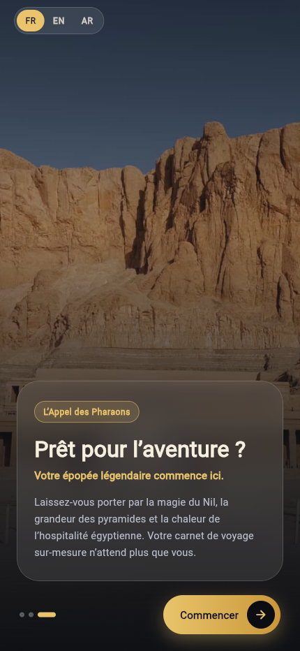
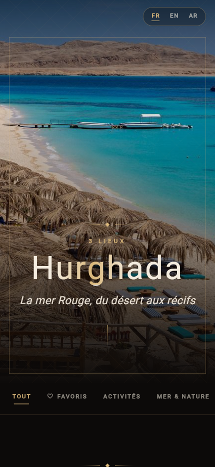
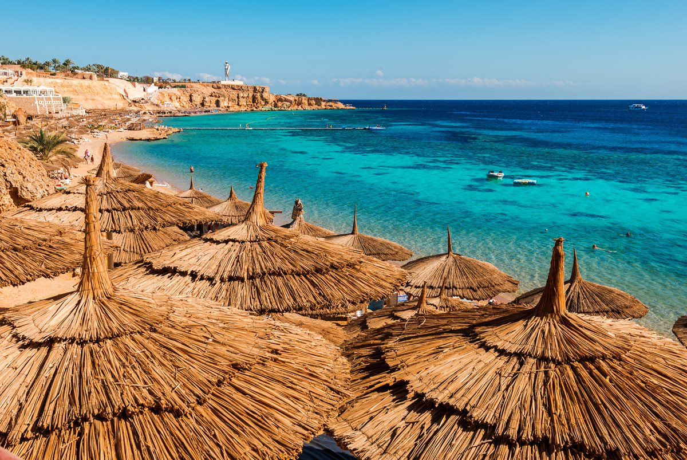

# 🇪🇬 Égypte

> **Voyagez en Égypte en toute sérénité.**

Découvrez l’Égypte autrement avec une application pensée pour vous accompagner dans la préparation de votre voyage. Explorez les destinations incontournables, découvrez la culture égyptienne et retrouvez des informations utiles dans une seule application.

## ✨ À propos de l’application

**Égypte** est une application mobile développée avec **Flutter**. Elle propose un guide de découverte du pays à travers ses villes, ses paysages, son patrimoine et sa culture.

Que vous prépariez votre premier séjour ou que vous souhaitiez simplement découvrir les merveilles égyptiennes, l’application vous invite à explorer le pays à votre rythme.

## 📲 Aperçu réel de l’application

Cette section présente le parcours de l’application **écran par écran**, dans l’ordre où un visiteur la découvre. Les captures sont prises depuis les véritables widgets Flutter du projet, exécutés dans Chromium avec un format mobile de **430 × 932 px**.

Pour les pages défilantes, le navigateur capture successivement plusieurs positions de défilement puis assemble les images en une seule capture verticale. L’image finale montre ainsi le contenu du haut jusqu’en bas, y compris lorsque Flutter conserve le défilement à l’intérieur de son propre écran. Les écrans de présentation sont capturés séparément pour montrer chacune des trois étapes.

> **À savoir :** ces images documentent les écrans réels de l’application. Les états nécessitant une action de l’utilisateur (par exemple ouvrir un menu, modifier un réglage ou saisir une valeur) sont présentés dans leur état de démonstration automatisé ; ils ne sont pas remplacés par des maquettes.

### 1. Choix de la langue


**Détails de l’écran :**
- Scène d’ouverture inspirée du Nil, avec une ambiance qui évolue au fil de la journée.
- Nom de l’application affiché dans la langue sélectionnée.
- Panneau de sélection des langues.
- Choix disponibles : français, anglais et arabe.
- Question, libellés et bouton de validation adaptés à la langue choisie.
- Mise en page adaptée à l’écriture de droite à gauche pour l’arabe.

### 2. Présentation — Découverte de l’Égypte


**Détails de l’écran :**
- Première étape de l’accueil introductif.
- Présentation de l’Égypte et de son univers.
- Mise en avant de son histoire, de ses sites, de sa culture et des expériences de voyage.
- Visuel immersif et textes localisés.

### 3. Présentation — Expériences


**Détails de l’écran :**
- Deuxième étape du parcours de présentation.
- Cartes illustrant plusieurs expériences : vallée des Rois, désert, croisière sur le Nil et traditions culinaires.
- Images, titres et pictogrammes associés à chaque expérience.
- Navigation vers l’étape suivante.

### 4. Présentation — Bienvenue



**Détails de l’écran :**
- Dernière étape de la présentation.
- Message invitant à commencer le voyage.
- Texte d’introduction et signature de l’univers de l’application.
- Accès à la création du profil.

### 5. Création du profil


**Détails de l’écran :**
- Écran de création du profil utilisateur.
- Interface localisée en français pour cette capture de référence.
- Présentation des informations nécessaires au profil.
- Étape de validation avant d’accéder à l’application.

### 6. Accueil


**Détails de l’écran :**
- Message de bienvenue et identité visuelle de l’application.
- En-tête et accès aux paramètres.
- Sélection de destinations recommandées selon le mois.
- Exploration des destinations par thème.
- Recherche d’une destination et affichage des résultats.
- Accès aux villes, aux régions, à la gastronomie et aux hiéroglyphes.
- Sections et contenus verticaux affichés dans leur intégralité.

### 7. Paramètres


**Détails de l’écran :**
- Personnalisation du nom et du profil.
- Choix du genre et de l’avatar.
- Sélection de la couleur du thème parmi les couleurs proposées.
- Choix de la langue de l’application : français, anglais ou arabe.
- Bouton d’enregistrement des modifications.

### 8. Le Caire


**Détails de l’écran :**
- Page consacrée à la capitale égyptienne.
- Présentation de la destination et de son identité.
- Contenus, visuels et sections de découverte présents dans la page.
- Capture verticale complète pour consulter les différentes sections.

### 9. Alexandrie


**Détails de l’écran :**
- Page consacrée à Alexandrie et à son patrimoine méditerranéen.
- Présentation de la destination.
- Images, textes et rubriques de découverte de la page.
- Capture verticale complète.

### 10. Louxor


**Détails de l’écran :**
- Page consacrée à Louxor et à son patrimoine antique.
- Présentation de la destination.
- Visuels et contenus de découverte.
- Capture verticale complète de la page.

### 11. Assouan


**Détails de l’écran :**
- Page consacrée à Assouan et aux paysages du Nil.
- Présentation de la destination.
- Images, textes et différentes sections de la page.
- Capture verticale complète.

### 12. Siwa


**Détails de l’écran :**
- Page consacrée à l’oasis de Siwa.
- Présentation de la destination et de son environnement.
- Contenus visuels et rubriques de découverte.
- Capture verticale complète.

### 13. Fayoum


**Détails de l’écran :**
- Page consacrée à la région du Fayoum.
- Présentation de ses paysages et de ses sites naturels.
- Images, textes et sections de découverte.
- Capture verticale complète.

### 14. Désert


**Détails de l’écran :**
- Page consacrée aux paysages désertiques égyptiens.
- Présentation de l’univers du désert.
- Visuels et contenus de découverte présents dans la page.
- Capture verticale complète.

### 15. Charm el-Cheikh


**Détails de l’écran :**
- Page consacrée à Charm el-Cheikh et à la mer Rouge.
- Présentation de la destination.
- Images, textes et rubriques de découverte.
- Capture verticale complète.

### 16. Hurghada



**Détails de l’écran :**
- Page consacrée à Hurghada.
- Présentation de la destination et de son littoral.
- Visuels et contenus de découverte présents dans la page.
- Capture verticale complète.

### 17. Gastronomie égyptienne


**Détails de l’écran :**
- Page dédiée à la cuisine égyptienne.
- Présentation des spécialités culinaires.
- Photographies, textes et contenus consacrés aux saveurs locales.
- Capture verticale complète.

### 18. Hiéroglyphes égyptiens


**Détails de l’écran :**
- Page dédiée aux hiéroglyphes et à l’écriture de l’Égypte ancienne.
- Présentation des symboles et de leur univers.
- Éléments visuels et contenus pédagogiques de la page.
- Capture verticale complète.

### Langues et parcours de navigation

L’application propose trois langues : **français, anglais et arabe**. Le code de l’accueil et des paramètres prévoit les trois localisations. Les captures de cette galerie utilisent le français comme langue de référence ; les écrans ne constituent donc pas trois séries de captures linguistiques distinctes.

Le parcours documenté suit l’ordre suivant : choix de la langue → présentation en trois étapes → création du profil → accueil → paramètres et rubriques de découverte.

### Mise à jour automatique des captures

Les captures sont générées par GitHub Actions à partir du code Flutter du dépôt, avec le fichier de démonstration `tool/screenshot_harness.dart`, Playwright et l’assemblage des captures dans Chromium. Le workflow se lance lors d’une mise à jour de la branche `main` (sauf lorsqu’il s’agit uniquement des captures) ou manuellement depuis l’onglet **Actions**.

Les images sont enregistrées dans `docs/screenshots/` et le workflow vérifie la présence des 18 fichiers avant de les valider dans le dépôt. Les captures correspondent à un rendu navigateur mobile de l’application Flutter, et non à des photographies prises sur un téléphone physique.

## 🏛️ Destinations à découvrir

L’application présente plusieurs régions et destinations d’Égypte :

- **Le Caire** – découvrez la capitale, son histoire et ses sites emblématiques.
- **Alexandrie** – explorez la ville méditerranéenne et son patrimoine.
- **Louxor** – plongez au cœur de l’Égypte antique.
- **Assouan** – découvrez le Nil et les paysages du sud.
- **Siwa** – partez à la découverte de l’oasis et du désert.
- **Fayoum** – explorez ses lacs et ses paysages naturels.
- **Le désert** – découvrez les grands espaces et les paysages désertiques.
- **Charm el-Cheikh** – profitez de la mer Rouge et de ses environs.
- **Hurghada** – découvrez une autre destination incontournable de la mer Rouge.

## 🖼️ Quelques destinations en images

| Le Caire | Alexandrie |
|:---:|:---:|
|  |  |
| **Louxor** | **Assouan** |
|  |  |
| **Siwa** | **Fayoum** |
|  |  |
| **Le désert** | **Charm el-Cheikh** |
|  |  |
| **Hurghada** | |
|  | |

## 🌍 Fonctionnalités

- **Découverte des destinations :** des pages consacrées aux principales régions touristiques du pays.
- **Culture et patrimoine :** des contenus pour découvrir l’histoire, les hiéroglyphes et les traditions égyptiennes.
- **Gastronomie :** une découverte de la cuisine et des spécialités locales.
- **Application multilingue :** interface disponible en français, en anglais et en arabe.
- **Profil personnalisé :** possibilité de configurer son profil et certains éléments de personnalisation.
- **Expérience mobile :** une navigation conçue pour consulter les informations facilement.

## 🛠️ Technologies utilisées

- [Flutter](https://flutter.dev/) – développement de l’application.
- [Dart](https://dart.dev/) – langage de programmation.
- [Google Fonts](https://pub.dev/packages/google_fonts) – typographie.
- [GetX](https://pub.dev/packages/get) – gestion de certaines fonctionnalités et de la navigation.
- [Shared Preferences](https://pub.dev/packages/shared_preferences) – sauvegarde locale des préférences.
- [URL Launcher](https://pub.dev/packages/url_launcher) – ouverture de liens externes.

## 🚀 Lancer le projet

Assurez-vous d’avoir installé [Flutter](https://docs.flutter.dev/get-started/install), puis clonez le dépôt :

```bash
git clone https://github.com/Coco921609/Egypte.git
cd Egypte
```

Installez les dépendances :

```bash
flutter pub get
```

Lancez l’application :

```bash
flutter run
```

Pour générer une version Web :

```bash
flutter build web --base-href "/Egypte/"
```

## 📁 Structure du projet

```text
Egypte/
├── assets/
│   └── images/        # Images des destinations
├── lib/               # Code source Flutter
├── test/              # Tests du projet
├── pubspec.yaml       # Dépendances et ressources
└── README.md          # Présentation du projet
```

## 📱 Télécharger l’application

| Plateforme | Accès |
|---|---|
| **Android** | [Télécharger sur Google Play](https://play.google.com/store/apps/details?id=com.egypte) |
| **iPhone / iPad (version Web)** | [Ouvrir l’application sur GitHub Pages](https://coco921609.github.io/Egypte/) |

## 🔗 Liens

- **Dépôt GitHub :** [Coco921609/Egypte](https://github.com/Coco921609/Egypte)
- **Documentation Flutter :** [docs.flutter.dev](https://docs.flutter.dev/)

---

**Égypte – Voyagez en Égypte en toute sérénité.** 🇪🇬
