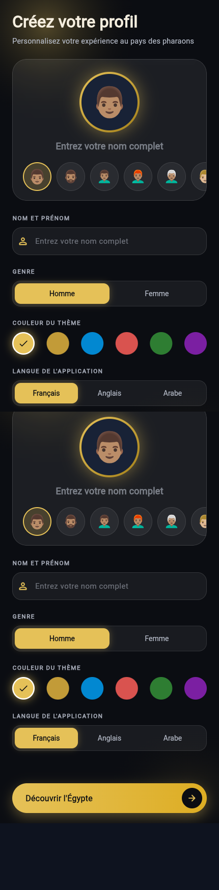
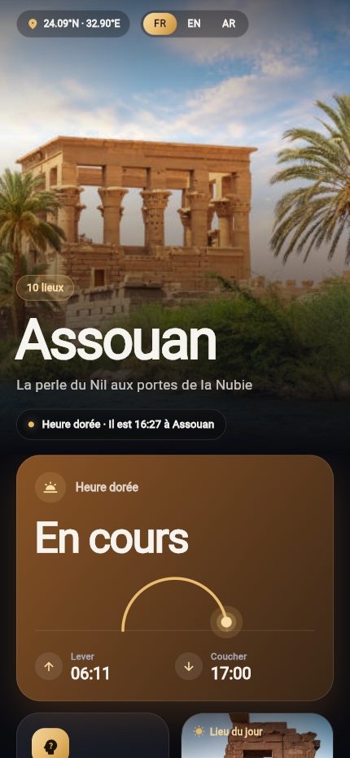
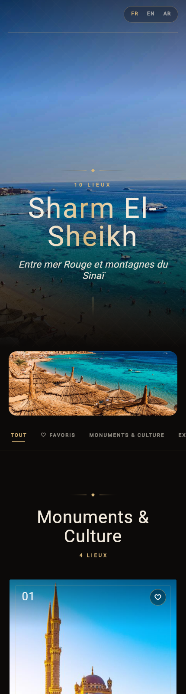
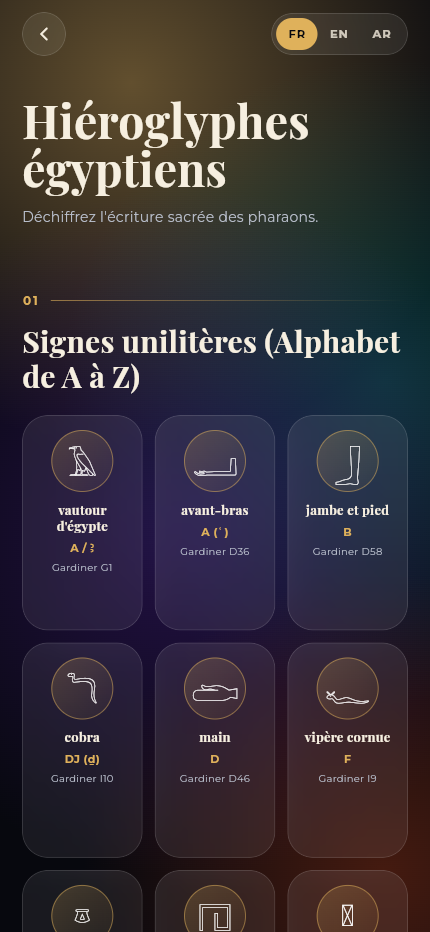

# 🇪🇬 Égypte

<p align="center">
  <strong>PARTEZ À LA DÉCOUVERTE DE L’ÉGYPTE, UN LIEU À LA FOIS.</strong><br>
  Des trésors de l’Antiquité aux paysages du désert et de la mer Rouge, explorez l’Égypte à votre rythme.
</p>

<p align="center">
  <a href="https://coco921609.github.io/Egypte/"><strong>Découvrir l’application</strong></a>
  &nbsp;·&nbsp;
  <a href="https://play.google.com/store/apps/details?id=com.egypte"><strong>▶ Télécharger sur Android</strong></a>
  &nbsp;·&nbsp;
  <a href="https://coco921609.github.io/Egypte/"><strong> Découvrir sur iOS / Web</strong></a>
  &nbsp;·&nbsp;
  <a href="https://github.com/Coco921609/Egypte"><strong>Code source</strong></a>
</p>

<p align="center">
  
  
  
</p>

---

## ✦ L’esprit Égypte

**Égypte** est une application Flutter conçue pour accompagner la découverte du pays. Elle rassemble des destinations, des paysages, des lieux historiques et des contenus culturels dans une expérience mobile immersive.

Du Caire à Alexandrie, de Louxor à Assouan, de l’oasis de Siwa aux rives de la mer Rouge, l’application invite à préparer son exploration et à découvrir différentes facettes de l’Égypte.

## ✦ Trois univers à explorer

| UNIVERS | CE QUI VOUS ATTEND |
|:--|:--|
| 🏛️ **Histoire & patrimoine** | Les villes historiques, les sites antiques et les trésors de l’Égypte ancienne |
| 🏜️ **Déserts & paysages** | Oasis, grands espaces, lacs et paysages naturels |
| 🌊 **Nil & mer Rouge** | Villes côtières, rives du Nil et destinations balnéaires |

## ✦ Le parcours de l’application

<p align="center">
  <strong>18 CAPTURES AUTHENTIQUES · 1 PAR ÉCRAN · 3 TEMPS DE DÉCOUVERTE</strong><br>
  <em>Du premier lancement aux destinations et aux contenus culturels.</em>
</p>

<p align="center">
  <em>Captures générées depuis les véritables écrans Flutter · Format mobile</em>
</p>

### 01 / Entrer dans l’expérience

<sub>CHOIX DE LA LANGUE · PRÉSENTATION · CRÉATION DU PROFIL</sub>

| **01 — Choix de la langue** | **02 — Découvrir l’Égypte** |
|:---:|:---:|
| <a href="docs/screenshots/01-choix-langue.png"></a> | <a href="docs/screenshots/02-presentation-decouverte.png"></a> |
| **03 — Les expériences** | **04 — Bienvenue** |
| <a href="docs/screenshots/03-presentation-experiences.png"></a> | <a href="docs/screenshots/04-presentation-bienvenue.png"></a> |
| **05 — Création du profil** | **06 — Accueil** |
| <a href="docs/screenshots/05-creation-profil.png"></a> | <a href="docs/screenshots/06-accueil.png"></a> |
| **07 — Paramètres** | |
| <a href="docs/screenshots/07-parametres.png"></a> | |

### 02 / Explorer les destinations

<sub>VILLES · OASIS · DÉSERT · MER ROUGE</sub>

| **08 — Le Caire** | **09 — Alexandrie** | **10 — Louxor** |
|:---:|:---:|:---:|
| <a href="docs/screenshots/08-le-caire.png"></a> | <a href="docs/screenshots/09-alexandrie.png"></a> | <a href="docs/screenshots/10-louxor.png"></a> |
| **11 — Assouan** | **12 — Siwa** | **13 — Fayoum** |
| <a href="docs/screenshots/11-assouan.png"></a> | <a href="docs/screenshots/12-siwa.png"></a> | <a href="docs/screenshots/13-fayoum.png"></a> |
| **14 — Le désert** | **15 — Charm el-Cheikh** | **16 — Hurghada** |
| <a href="docs/screenshots/14-desert.png"></a> | <a href="docs/screenshots/15-sharm-el-sheikh.png"></a> | <a href="docs/screenshots/16-hurghada.png"></a> |

### 03 / Découvrir la culture égyptienne

<sub>GASTRONOMIE · HISTOIRE · HIÉROGLYPHES</sub>

| **17 — Gastronomie égyptienne** | **18 — Hiéroglyphes** |
|:---:|:---:|
| <a href="docs/screenshots/17-gastronomie.png"></a> | <a href="docs/screenshots/18-hieroglyphes.png"></a> |

<sub>Cliquez sur une image pour consulter la capture originale en grand format. Chaque écran possède son propre fichier PNG.</sub>

## ✦ Destinations à découvrir

| DESTINATION | APERÇU |
|:--|:--|
| **Le Caire** | La capitale égyptienne et ses sites emblématiques |
| **Alexandrie** | Le patrimoine et l’atmosphère méditerranéenne |
| **Louxor** | Les grands témoignages de l’Égypte antique |
| **Assouan** | Le Nil et les paysages du sud |
| **Siwa** | Une oasis au cœur du désert |
| **Fayoum** | Des lacs et des paysages naturels |
| **Désert** | Les grands espaces et les paysages désertiques |
| **Charm el-Cheikh** | La mer Rouge et ses environs |
| **Hurghada** | Une destination incontournable du littoral de la mer Rouge |

## ✦ Fonctionnalités

- Découverte de destinations et de régions égyptiennes.
- Pages consacrées aux villes, aux paysages et aux lieux historiques.
- Contenus dédiés à la gastronomie égyptienne.
- Découverte des hiéroglyphes et de la culture de l’Égypte ancienne.
- Interface disponible en français, en anglais et en arabe.
- Création et personnalisation du profil.
- Paramètres et préférences de l’application.
- Navigation conçue pour une expérience mobile.

## ✦ Technologies

| TECHNOLOGIE | UTILISATION |
|:--|:--|
| **Flutter / Dart** | Développement multiplateforme |
| **GetX** | Gestion de certaines fonctionnalités et de la navigation |
| **Google Fonts** | Typographie |
| **Shared Preferences** | Préférences locales |
| **URL Launcher** | Ouverture de liens externes |
| **GitHub Actions** | Déploiement Web et génération automatisée des captures |
| **Playwright / Chromium** | Rendu et captures des écrans Flutter |

## ✦ Mise à jour automatique des captures

Les captures sont générées par GitHub Actions à partir du code Flutter du dépôt, avec le fichier **tool/screenshot_harness.dart** et Playwright dans Chromium. Le workflow crée une image distincte pour chacun des 18 écrans, vérifie que les fichiers sont présents et contrôle qu’ils ne sont pas identiques avant de les enregistrer dans **docs/screenshots/**.

Le workflow se lance lors d’une mise à jour de la branche **main** (sauf lorsque seuls les fichiers de captures changent) ou manuellement depuis l’onglet **Actions**. Les images montrent le rendu navigateur mobile de l’application Flutter ; elles ne sont pas des photographies promotionnelles ni des captures prises sur un téléphone physique.

## ✦ Installer le projet

Prérequis : [Flutter](https://docs.flutter.dev/get-started/install) installé et configuré.

    git clone https://github.com/Coco921609/Egypte.git
    cd Egypte
    flutter pub get
    flutter run

Pour générer la version Web :

    flutter build web --base-href "/Egypte/"

## ✦ Télécharger l’application

- **Android — Google Play :** [Télécharger l’application](https://play.google.com/store/apps/details?id=com.egypte)
- **iOS / Web :** [Découvrir l’application](https://coco921609.github.io/Egypte/)
- **Dépôt GitHub :** [Coco921609/Egypte](https://github.com/Coco921609/Egypte)
- **Documentation Flutter :** [docs.flutter.dev](https://docs.flutter.dev/)

---

<p align="center">
  <strong>ÉGYPTE</strong><br>
  <em>Un voyage au cœur de l’histoire, des paysages et de la culture égyptienne.</em>
</p>


## ✦ Ouvrir ce projet Flutter dans Android Studio

Ce guide explique comment récupérer, configurer et lancer **Égypte** avec Android Studio sous Windows, macOS (pour iOS) et Linux.

### 1. Installer les outils nécessaires

Installez les outils suivants avant d'ouvrir le projet :

- **Git** : https://git-scm.com/downloads
- **Flutter SDK** : https://docs.flutter.dev/get-started/install
- **Android Studio** : https://developer.android.com/studio

Dans Android Studio, ouvrez **Settings / Preferences → Plugins → Marketplace**, recherchez **Flutter**, puis installez le plugin Flutter (le plugin Dart sera également proposé). Redémarrez Android Studio.

Dans **SDK Manager**, installez un Android SDK récent ainsi que les outils de plateforme et de compilation proposés. Dans **Device Manager**, créez un émulateur Android ou préparez un téléphone avec le débogage USB activé.

### 2. Récupérer le projet

Ouvrez un terminal (PowerShell sous Windows, Terminal sous macOS ou Linux), puis exécutez :

```bash
git clone https://github.com/Coco921609/Egypte.git
cd Egypte
```

Vérifiez que vous êtes dans le dossier **Egypte**, celui qui contient le fichier `pubspec.yaml`.

### 3. Configurer Windows

1. Téléchargez le SDK Flutter pour Windows et décompressez-le dans un emplacement simple, par exemple `C:\src\flutter`.
2. Ajoutez `C:\src\flutter\bin` à la variable d’environnement **Path** de Windows.
3. Fermez puis rouvrez PowerShell et vérifiez l’installation :

```powershell
flutter --version
flutter doctor
```

4. Dans Android Studio, ouvrez **SDK Manager** et installez le SDK Android et les outils nécessaires.
5. Acceptez les licences Android :

```powershell
flutter doctor --android-licenses
flutter doctor
```

6. Pour exécuter l’application Windows elle-même (en plus d'Android), installez **Visual Studio** avec la charge de travail **Desktop development with C++**. Android Studio seul ne fournit pas le compilateur Windows requis.

### 4. Configurer macOS et iOS

1. Installez Flutter pour macOS et ajoutez le dossier `flutter/bin` à votre PATH selon la documentation Flutter.
2. Installez Android Studio si vous souhaitez également lancer l’application sur Android.
3. Pour compiler ou lancer sur iPhone/iOS, installez **Xcode** depuis le Mac App Store.
4. Ouvrez Terminal et configurez les outils en ligne de commande :

```bash
xcode-select --install
sudo xcodebuild -runFirstLaunch
flutter doctor
```

5. Ouvrez Xcode une première fois et acceptez ses conditions si cela est demandé.
6. Pour tester, démarrez un simulateur depuis Xcode (**Xcode → Open Developer Tool → Simulator**) ou connectez un iPhone autorisé.

**Important :** la compilation, la signature et l’exécution iOS nécessitent un Mac avec Xcode. Il n’est pas possible de construire une application iOS nativement depuis Windows ou Linux.

### 5. Configurer Linux

1. Installez Git et les dépendances système requises par Flutter pour votre distribution (consultez la documentation Flutter Linux).
2. Téléchargez et installez le SDK Flutter pour Linux, puis ajoutez `flutter/bin` à votre PATH.
3. Installez Android Studio et les outils Android SDK.
4. Dans un terminal, vérifiez la configuration et acceptez les licences :

```bash
flutter --version
flutter doctor
flutter doctor --android-licenses
```

5. Pour exécuter une version Linux desktop, installez également les dépendances de compilation Linux indiquées dans la documentation Flutter.

### 6. Ouvrir Égypte dans Android Studio

1. Lancez **Android Studio**.
2. Cliquez sur **Open**.
3. Sélectionnez le dossier cloné **Egypte** (ne sélectionnez pas uniquement le dossier `android`).
4. Attendez l’indexation du projet.
5. Ouvrez le terminal intégré d’Android Studio et exécutez :

```bash
flutter pub get
```

Si Android Studio demande de configurer le chemin du SDK Flutter, indiquez le dossier dans lequel vous avez installé Flutter.

### 7. Lancer l’application

1. Démarrez un émulateur depuis **Device Manager**, ou connectez un appareil physique.
2. Vérifiez que Flutter le détecte :

```bash
flutter devices
```

3. Dans Android Studio, choisissez l’appareil dans la liste en haut, puis cliquez sur **Run ▶**. Vous pouvez aussi lancer depuis le terminal :

```bash
flutter run
```

Pour lancer la version Web dans Chrome :

```bash
flutter run -d chrome
```

Pour générer les fichiers Web destinés au site GitHub Pages de ce dépôt :

```bash
flutter build web --base-href "/Egypte/"
```

### 8. En cas de problème

- Exécutez `flutter doctor -v` pour obtenir un diagnostic détaillé.
- Vérifiez que le dossier Flutter est bien dans le PATH et que le chemin du SDK est configuré dans Android Studio.
- Après avoir récupéré le projet ou modifié ses dépendances, relancez `flutter pub get`.
- Si aucun appareil n’apparaît, démarrez l’émulateur ou vérifiez la connexion USB et le débogage USB du téléphone.

**Documentation officielle :** [Installer Flutter](https://docs.flutter.dev/get-started/install) · [Configurer Android](https://docs.flutter.dev/platform-integration/android/setup) · [Configurer iOS](https://docs.flutter.dev/platform-integration/ios/setup) · [Configurer Linux](https://docs.flutter.dev/platform-integration/linux/setup) · [Configurer Windows](https://docs.flutter.dev/platform-integration/windows/setup)
